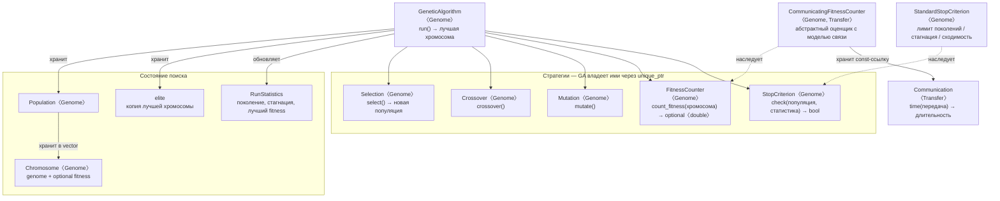
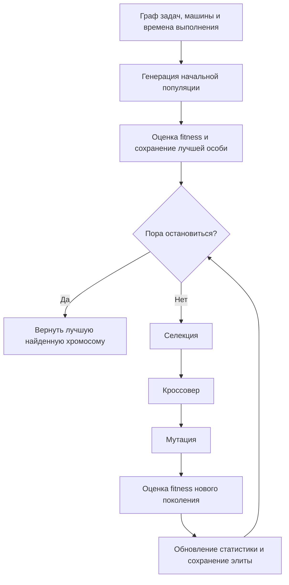

# Генетический алгоритм для построения расписаний

## Содержание

- [Структура проекта](#структура-проекта)
- [Расписание на машинах](#расписание-на-машинах)
- [Текущая схема](#текущая-схема)
- [Цикл алгоритма](#цикл-алгоритма)
- [Паттерны проектирования](#паттерны-проектирования)
- [Запуск](#запуск)

## Структура проекта

- `genetic_algorithm/` — общие типы и абстрактные интерфейсы генетического алгоритма.
- `heterogeneous_machines/` — распределение зависимых задач между неоднородными машинами.
- `heterogeneous_machines/selections/`, `mutations/`, `crossovers/` — конкретные стратегии для задачи расписания.
- `tests/` — проверки общей библиотеки, стратегий, расчёта fitness и топологической сортировки.

## Расписание на машинах

Уже работает полный запуск на небольшом примере. Геном хранит назначение машин в `matching` и порядок размещения задач в `scheduling`. Начальная популяция создаётся случайно, зависимости задач учитываются через топологическую сортировку.

Добавлены три базовые стратегии.

- `TournamentSelection` выбирает лучшую из двух случайных особей по меньшему fitness.
- `ScheduleCrossover` обменивает части `matching` между двумя родителями.
- `ScheduleMutation` меняет назначение машины и пробует переставить две задачи. После перестановки восстанавливает допустимый порядок.

`ScheduleFitnessCounter` считает makespan — время завершения всего расписания. Учитываются занятость машин, зависимости и время передачи данных. Независимые задачи на разных машинах могут выполняться параллельно.

Время передачи рассчитывается по объёму данных, пропускной способности сети и машин, с учётом задержки. Учёт конкуренции передач за общие ресурсы ещё предстоит добавить.

## Текущая схема




`Genome` и `Transfer` задаются конкретной задачей. Пунктиром показано наследование; сплошными стрелками — хранение и использование компонентов.

## Цикл алгоритма



Время выполнения задач и передачи данных учитывается при оценке fitness. Остановка проверяется по числу поколений, отсутствию улучшений или, при включённой проверке, равенству всех fitness.

## Паттерны проектирования

`GeneticAlgorithm` задуман как **Фасад**. Через `run()` запускается цикл оценки, селекции, кроссовера, мутации и проверки остановки. Начальная популяция передаётся готовой.

Селекция, мутация, кроссовер и другие компоненты передаются через общие интерфейсы. Их реализации можно заменять, сохраняя сам цикл алгоритма. Это паттерн **Стратегия**.

## Запуск

Общая библиотека подключается через `genetic_algorithm/ga.hpp`. В конструктор `GeneticAlgorithm` передаются готовая популяция и пять стратегий через `unique_ptr`. `run()` возвращает лучшую найденную хромосому, `stats()` — статистику поиска.

Пример полного запуска находится в `heterogeneous_machines/scheduling.cpp`. Входные данные пока заданы прямо в коде. Программа выводит начальный и итоговый makespan, лучшую хромосому и число поколений.

Из корня проекта, с GCC и C++20.

```powershell
g++ -std=c++20 -I . heterogeneous_machines/scheduling.cpp -o scheduling.exe
if ($LASTEXITCODE -eq 0) { .\scheduling.exe }
```

Основные условия работы библиотеки.

- Популяция непустая. Селекция возвращает новую того же размера; кроссовер и мутация меняют её по ссылке, сохраняя размер. Вероятности задаются внутри операторов.
- По умолчанию меньшее fitness лучше. Для максимизации можно передать `std::greater<double>{}`; селекция должна сравнивать в том же направлении. После изменения геномов оценки сбрасываются и вычисляются заново.
- `count_fitness()` возвращает `std::optional<double>`. Пустая оценка, NaN и бесконечности при запуске GA приводят к исключению.
- Элита хранится отдельной копией. Если новое поколение хуже, она заменяет худшую особь.
- `StandardStopCriterion` проверяет лимит поколений, стагнацию и, при включённом флаге, равенство всех fitness. Нулевой лимит поколений оставляет только начальную оценку; нулевой лимит стагнации отключает эту проверку.
- Модель `Communication` возвращает конечную неотрицательную длительность и должна жить дольше использующего её оценщика.
- Повторный `run()` сбрасывает счётчики и начинает с текущей популяции. При исключении отката нет.

### Тесты

Тесты GA и расписания используют Catch2, у топологической сортировки отдельная тестовая программа.

```powershell
cmake -S . -B build
cmake --build build --target ga_tests scheduling_tests topological_sort_tests
ctest --test-dir build --output-on-failure
```

CMake скачивает Catch2 при первой настройке. В текущем `CMakeLists.txt` также есть учебная цель `tests`, для которой нужен локальный файл `practice_temp/test_math.cpp`.

