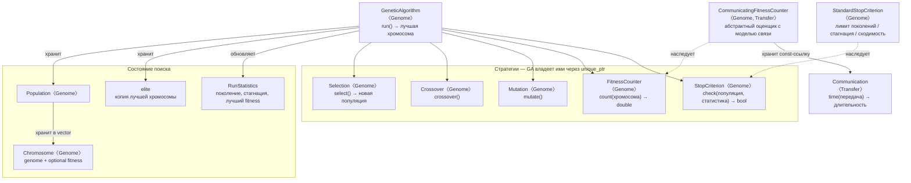

# Генетический алгоритм для построения расписаний

## Содержание

- [Структура проекта](#структура-проекта)
- [Текущая схема](#текущая-схема)
- [Паттерны проектирования](#паттерны-проектирования)
- [Запуск общей библиотеки](#запуск-общей-библиотеки)

## Структура проекта

- `genetic_algorithm/` — общие типы и абстрактные интерфейсы генетического алгоритма.
- `heterogeneous_machines/` — реализация задачи расписания, распределение подзадач по машинами.


## Текущая схема




`Genome` и `Transfer` задаются конкретной задачей. Пунктиром показано наследование; сплошными стрелками — хранение и использование компонентов.

## Паттерны проектирования

`GeneticAlgorithm` задуман как **Фасад**: оставляем простой интерфейс запуска, а внутри скрываем порядок работы генерации популяции, оценки, селекции, кроссовера, мутации и проверки остановки.

В дальнейшем во второй библиотеке появятся разные варианты мутации, селекции и других компонентов. Их можно будет передавать в `GeneticAlgorithm` через общие интерфейсы, не меняя сам цикл алгоритма. Это паттерн **Стратегия**.

## Запуск общей библиотеки

Подключение: [`genetic_algorithm.hpp`](genetic_algorithm/genetic_algorithm.hpp). В конструктор передаются готовая популяция и пять стратегий через `unique_ptr`. `run()` возвращает лучшую найденную хромосому, `stats()` — статистику поиска.

Сначала оценивается начальная популяция и сохраняется элита. Далее: **селекция → кроссовер → мутация → оценивание → элитизм**. Перед каждым поколением проверяется остановка: `check() == true` завершает поиск.

Контракты:

- Популяция непустая. Селекция возвращает новую того же размера; кроссовер и мутация меняют её по ссылке, сохраняя размер. Вероятности задаются внутри операторов.
- По умолчанию меньшее fitness лучше. Для максимизации можно передать `std::greater<double>{}`; селекция должна сравнивать в том же направлении. После изменения геномов оценки сбрасываются и вычисляются заново.
- Элита хранится отдельной копией. Если новое поколение хуже, она заменяет худшую особь.
- `StandardStopCriterion` проверяет лимит поколений, стагнацию и, при включённом флаге, равенство всех fitness. Нулевой лимит поколений оставляет только начальную оценку; нулевой лимит стагнации отключает эту проверку.
- Модель `Communication` возвращает конечную неотрицательную длительность и должна жить дольше использующего её оценщика. Расписание передач и перекрытие с вычислениями рассчитывает вторая библиотека.
- Повторный `run()` сбрасывает счётчики и начинает с текущей популяции. При исключении отката нет.

**Тесты:** [`tests/ga_tests.cpp`](tests/ga_tests.cpp). Десять отдельных проверок цикла, элитизма, остановки, communication time и ошибок.

В VS Code открой этот файл и нажми **Ctrl+F5**. Или собери из корня проекта:

```powershell
g++ -std=c++20 -Wall -Wextra -Wpedantic -I genetic_algorithm tests/ga_tests.cpp -o ga_tests.exe
if ($LASTEXITCODE -eq 0) { .\ga_tests.exe }
```

Каждый тест выводит `[PASS]` или `[FAIL]`. При ошибках программа возвращает код `1`.

